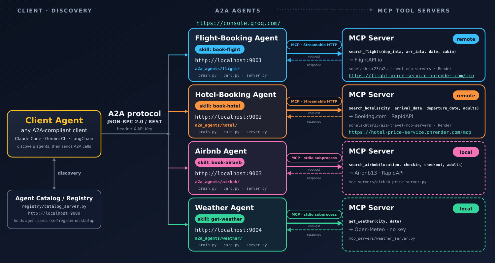

# A2A Travel Agents

Four autonomous AI agents — Flight, Hotel, Airbnb, and Weather — that communicate over the official **[A2A (Agent2Agent) Protocol](https://a2a-protocol.org/)**, each backed by real, live data through the **[Model Context Protocol (MCP)](https://modelcontextprotocol.io/)**. Every agent runs a LangGraph agent internally and is reachable by any standard A2A client (Gemini CLI, LangChain, etc.) with zero custom integration code.

Two of the four MCP tool servers run **locally** (spawned as a subprocess), and two run **remotely** (independently deployed web services on Render), so the project demonstrates both ways an agent can reach an MCP tool:

| Agent | MCP transport | Tool server |
|---|---|---|
| Flight | Remote (Streamable HTTP) | [a2a-travel-mcp-servers](https://github.com/sohelakhtar23/a2a-travel-mcp-servers) on Render |
| Hotel | Remote (Streamable HTTP) | [a2a-travel-mcp-servers](https://github.com/sohelakhtar23/a2a-travel-mcp-servers) on Render |
| Weather | Local (stdio subprocess) | `mcp_servers/weather_server.py` |
| Airbnb | Local (stdio subprocess) | `mcp_servers/airbnb_price_server.py` |



## Table of Contents

- [Overview](#overview)
- [Agents](#agents)
- [Architecture](#architecture)
- [Project Structure](#project-structure)
- [Prerequisites](#prerequisites)
- [Installation](#installation)
- [Configuration](#configuration)
- [Running the Agents](#running-the-agents)
- [Usage](#usage)
- [Authentication](#authentication)
- [Tech Stack](#tech-stack)

## Overview

Each agent is an independent A2A server: it publishes a real **Agent Card**, accepts real **JSON-RPC/REST** requests, and drives a real **Task** through the protocol's official state machine. Internally, each agent's reasoning is powered by a LangGraph ReAct agent (via Groq), which decides when to call out to a real external data source over MCP — no mocked or synthetic data for prices, listings, or weather.

There's also a lightweight **Agent Catalog**, a discovery service agents register with on startup so clients can look one up by skill instead of hardcoding a URL.

## Agents

| Agent | Skill | Data Source |
|---|---|---|
| **Flight** | `book-flight` | Real live fares for a specific date — [SerpApi.com](https://www.serpapi.com/) (key already provisioned on the remote server — no signup needed to run this project) |
| **Hotel** | `book-hotel` | Real hotel prices for specific dates — [via SerpApi.com](https://serpapi.com/)  (key already provisioned on the remote server — no signup needed to run this project) |
| **Airbnb** | `book-airbnb` | Real Airbnb listings for specific dates — [Airbnb13](https://rapidapi.com/3b-data-3b-data-default/api/airbnb13) (via RapidAPI) — **you need your own free RapidAPI key subscribed to this one**, see [Configuration](#configuration) |
| **Weather** | `get-weather` | Real current conditions or a 16-day forecast — [Open-Meteo](https://open-meteo.com/) |

Every field in every agent's result is real, live data for the dates requested — no synthetic or made-up fields anywhere. There's no free API that can issue an actual seat/PNR or hotel/Airbnb reservation confirmation, so these agents simply don't claim to hand one back.

## Architecture

```
Client (curl / Gemini CLI / LangChain / anything A2A-compliant)
        │
        │  1. GET  /.well-known/agent-card.json
        │  2. POST /  (JSON-RPC "SendMessage")  or  POST /message:send  (REST)
        ▼
┌───────────────────────────────────────────┐
│  Agent server (a2a-sdk)                    │
│   • Agent Card, Task lifecycle, auth       │
│   • common/executor.py  (protocol adapter) │
└───────────────────┬─────────────────────────┘
                     │  calls
                     ▼
┌───────────────────────────────────────────┐
│  Agent brain (LangGraph + Groq)            │
│   • decides what to ask / when to call a  │
│     tool                                   │
└───────────────────┬─────────────────────────┘
                     │  MCP tool call
                     ▼
        ┌────────────┴────────────┐
        ▼                         ▼
┌──────────────────┐   ┌────────────────────────────┐
│  Local MCP server │   │  Remote MCP server          │
│  (stdio subprocess)│   │  (Streamable HTTP, Render)  │
│  weather, airbnb   │   │  flight, hotel               │
│  mcp_servers/*.py  │   │  github.com/sohelakhtar23/          │
│                    │   │  a2a-travel-mcp-servers      │
└──────────────────┘   └────────────────────────────┘
```

`common/executor.py` is the only file in the project that touches the `a2a-sdk` directly. Every agent's `brain.py` is pure business logic and has no dependency on A2A at all — the same brain could be dropped behind any other transport.

## Project Structure

```
a2a-demo/
├── .env                          # your API keys (not committed)
├── .env.example                  # template for the above
├── pyproject.toml                # dependencies (managed with uv)
├── registry/
│   └── catalog_server.py         # agent discovery service
├── mcp_servers/                  # LOCAL MCP tool servers (stdio subprocess)
│   ├── airbnb_price_server.py
│   └── weather_server.py
│   # (flight + hotel tools run REMOTELY instead -- see
│   #  github.com/sohelakhtar23/a2a-travel-mcp-servers)
├── common/
│   ├── config.py                 # loads .env, LLM provider selection
│   ├── llm.py                    # builds the LangChain chat model object
│   ├── turn_result.py            # contract between a brain and the executor
│   ├── executor.py               # the A2A protocol adapter (AgentExecutor)
│   ├── agent_card_builder.py     # shared Agent Card construction
│   ├── auth.py                   # API-key authentication middleware
│   └── registry_client.py        # registers an agent with the catalog
└── a2a_agents/
    ├── flight/    { brain.py, card.py, server.py }
    ├── hotel/     { brain.py, card.py, server.py }
    ├── weather/   { brain.py, card.py, server.py }
    └── airbnb/    { brain.py, card.py, server.py }
```

## Prerequisites

- Python 3.12+
- [uv](https://docs.astral.sh/uv/getting-started/installation/)
- API keys listed in [Configuration](#configuration)

## Installation

This project uses [uv](https://docs.astral.sh/uv/) for dependency management.

```bash
git clone https://github.com/sohelakhtar23/a2a-mcp-project.git
cd a2a-mcp-project
uv sync
```

`uv sync` creates the `.venv/` and installs the exact versions pinned in
`uv.lock`. Prefix commands with `uv run` (e.g. `uv run python
a2a_agents/weather/server.py`), or activate the environment once with
`source .venv/bin/activate` (Windows: `.venv\Scripts\activate`).

## Configuration

Create a `.env` file at the project root:

```env
GROQ_API_KEY=
RAPIDAPI_KEY=
AGENT_API_KEY=
```

| Variable | Used by | Where to get it | Notes |
|---|---|---|---|
| `GROQ_API_KEY` | All agents (LLM) | [console.groq.com/keys](https://console.groq.com/keys) | Free |
| `RAPIDAPI_KEY` | Airbnb agent (local) | [rapidapi.com](https://rapidapi.com) | Subscribe to the free tier of [Airbnb13](https://rapidapi.com/3b-data-3b-data-default/api/airbnb13) |
| `AGENT_API_KEY` | All agents (auth) | Generate your own, e.g. `openssl rand -hex 32` | Not from an external service — see [Authentication](#authentication) |

The Weather agent needs no key — [Open-Meteo](https://open-meteo.com/) is free with no signup.

The Flight and Hotel agents also need no local key — they call remote MCP servers already deployed on Render, which hold their own `SERPAPI_API_KEY`. That server code (and how to deploy your own copy) lives at [github.com/sohelakhtar23/a2a-travel-mcp-servers](https://github.com/sohelakhtar23/a2a-travel-mcp-servers).

To switch the LLM provider between Groq and OpenAI, change `PROVIDER` in `common/config.py`.

## Running the Agents

Every agent is a Python package and must be run with `-m` from the project root (this puts the project root on the import path, which `common/*` imports depend on).

```bash
# Terminal 1 — Agent Catalog (start first)
python registry/catalog_server.py

# Terminal 2
python -m a2a_agents.flight.server

# Terminal 3
python -m a2a_agents.hotel.server

# Terminal 4
python -m a2a_agents.weather.server

# Terminal 5
python -m a2a_agents.airbnb.server
```

Each agent prints its port and Agent Card URL on startup.

| Agent | Port |
|---|---|
| Catalog | 9000 |
| Flight | 9001 |
| Hotel | 9002 |
| Airbnb | 9003 |
| Weather | 9004 |

## Usage

**Fetch an Agent Card** (no authentication required):

```bash
curl http://localhost:9001/.well-known/agent-card.json
```

**Send a message — JSON-RPC** (requires `X-API-Key`):

```bash
curl -X POST http://localhost:9001/ \
  -H "Content-Type: application/json" \
  -H "A2A-Version: 1.0" \
  -H "X-API-Key: <your AGENT_API_KEY>" \
  -d '{
    "jsonrpc": "2.0",
    "id": "1",
    "method": "SendMessage",
    "params": {
      "message": {
        "role": "ROLE_USER",
        "parts": [{"text": "Book a flight Lahore to Karachi on 2026-08-10, economy"}],
        "messageId": "msg-1"
      }
    }
  }'
```

The response includes `task.id` and `task.contextId`. To continue the conversation, send another message with the same IDs:

```bash
curl -X POST http://localhost:9001/ \
  -H "Content-Type: application/json" \
  -H "A2A-Version: 1.0" \
  -H "X-API-Key: <your AGENT_API_KEY>" \
  -d '{
    "jsonrpc": "2.0",
    "id": "2",
    "method": "SendMessage",
    "params": {
      "message": {
        "role": "ROLE_USER",
        "parts": [{"text": "economy, please"}],
        "messageId": "msg-2",
        "taskId": "<task id from previous response>",
        "contextId": "<context id from previous response>"
      }
    }
  }'
```

**Or the REST binding:**

```bash
curl -X POST http://localhost:9001/message:send \
  -H "Content-Type: application/json" \
  -H "A2A-Version: 1.0" \
  -H "X-API-Key: <your AGENT_API_KEY>" \
  -d '{
    "message": {
      "role": "ROLE_USER",
      "parts": [{"text": "Book a flight Lahore to Karachi on 2026-08-10, economy"}],
      "messageId": "msg-1"
    }
  }'
```

**Discover an agent by skill via the Catalog:**

```bash
curl "http://localhost:9000/agents/search?skill=book-flight"
```

## Authentication

Every agent requires an API key, sent as the `X-API-Key` header, on every request except fetching its public Agent Card. Requests missing a valid key receive `401 Unauthorized` before reaching any A2A routing logic.

This is a single shared secret (`AGENT_API_KEY`), enforced by `common/auth.py` via Starlette's standard authentication middleware. Each Agent Card declares this requirement in its `securitySchemes`/`securityRequirements` fields, so any A2A-compliant client knows exactly what credentials to send.

Keys are compared with `hmac.compare_digest` rather than `==`, so a wrong key takes the same time to reject regardless of how many leading characters are correct. An agent **refuses to start** if `AGENT_API_KEY` is unset or still the placeholder from `.env.example` — otherwise a missing `.env` would silently fall back to a value published in this repo and the agent would come up looking authenticated while accepting a well-known key.

The catalog's `POST /register` requires the same key. Registering writes to the phone book every client trusts, so leaving it open would let anyone who can reach port 9000 overwrite a real agent's entry with their own URL and quietly receive users' travel details. Reads stay open — discovery is the point of the catalog. Re-registering an existing agent *name* at a different URL is rejected with `409`, so even a leaked key can't silently repoint an agent at another address.

Conversation memory is namespaced by authenticated caller, not by task ID alone. The A2A task ID comes straight from the client's message, and each brain's LangGraph checkpointer is keyed only by `thread_id` — so keying memory on the raw task ID would let anyone who learned another caller's task ID resume that conversation and have the model replay its details back. `common/executor.py` derives the memory key as `<caller>:<task_id>`. With one shared key that's a single namespace today; it means moving to per-caller keys makes the isolation real rather than leaving a cross-tenant leak behind.

All services bind to `127.0.0.1`. Change this deliberately when deploying — binding `0.0.0.0` on an untrusted network exposes the agents, and your LLM/API quota, to the whole LAN.

## Tests

A client-side test harness lives in `tests/`. It drives the real A2A servers
(real executor, auth, agent cards, JSON-RPC/REST routing, task state machine,
multi-turn continuation, and the registry) and injects deterministic fakes
only at the two external boundaries (the LLM and the MCP data call), so it
runs with no external API keys and no network. It does need `AGENT_API_KEY`
set (the agents refuse to start without one) and the catalog running, since
the matrix exercises registration:

```
# Terminal 1
AGENT_API_KEY=test-secret-key python registry/catalog_server.py

# Terminal 2
AGENT_API_KEY=test-secret-key uv run python -m tests.run_matrix
```

- `tests/fakes.py` -- the fake LLM + canned real-shaped MCP tools.
- `tests/run_matrix.py` -- the full pass/fail matrix over all four agents
  plus the catalog (happy path, slot-filling, multi-turn, REST binding,
  auth 401s, malformed-request handling, ground-truth artifact checks,
  per-caller memory isolation, and registry auth / name-takeover).
- `tests/live_weather_server.py` -- launches the Weather agent as a real
  uvicorn process with the LLM faked but the Open-Meteo call REAL, for an
  authentic external round trip you can curl.

To exercise the real LLM and live data instead, set your keys in `.env` and
remove the `get_tools` fake lines in `run_matrix.py`.

## Tech Stack

- [A2A Protocol](https://a2a-protocol.org/) / [`a2a-sdk`](https://github.com/a2aproject/a2a-python)
- [Model Context Protocol](https://modelcontextprotocol.io/) (`mcp` Python SDK)
- [LangGraph](https://github.com/langchain-ai/langgraph) / [`langchain-mcp-adapters`](https://github.com/langchain-ai/langchain-mcp-adapters)
- [Groq](https://groq.com/) (LLM inference)
- [FastAPI](https://fastapi.tiangolo.com/) / [Starlette](https://www.starlette.io/) / [Uvicorn](https://www.uvicorn.org/)


## Acknowledgements
[Dr. Muhammad Arif Butt](https://github.com/arifpucit)
